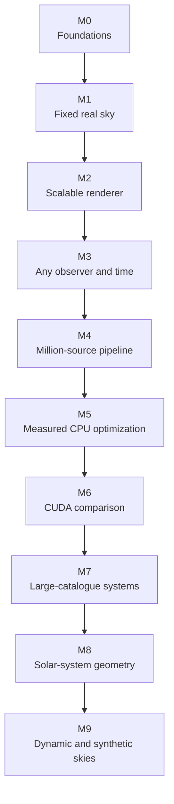

<div align="center">


# MyStarCeiling

### Recreate the night sky. Any place. Any time.

[]()
[]()
[]()
[]()

</div>

---

## Overview

MyStarCeiling is a C++ engine for reconstructing, generating, modifying, and
rendering night skies.

Given an observer, a location, and a time, it aims to reproduce the visible sky
from astronomical catalog data. The same engine can generate deterministic
synthetic skies and apply explicit artistic modifications without confusing
them with reconstructed observations.

MyStarCeiling is intended to work offline and to remain independent of any
single output device. Its generated scenes may be displayed on screen, exported
for other software, or eventually used to drive optical-fibre and LED ceiling
installations.

The project is also a serious exploration of modern C++ applied to a
substantial astronomy, systems, and performance problem. Its implementation
emphasizes ownership, data modeling, numerical correctness, algorithms,
testing, architecture, scalability, profiling, and measured optimization.

---

## Run the current M1 slice

After configuring the project, build and test with:

```sh
cmake --build build -j4
ctest --test-dir build --output-on-failure
build/src/cli/mystarceiling_cli \
  data/gaia-dr3/gaia-dr3.csv.gz.partial \
  data/hipparcos2/runs/20260912T191816.016104Z/hipparcos2-supplement.csv.gz \
  /tmp/msc-m1.bin
```

The Gaia argument uses the existing local acquisition checkpoint's ordered prefix.
The application selects 4096 combined Gaia/Hipparcos stars, calculates the fixed
Toulouse sky, and applies an owner-approved **temporary G<=4 display filter**.
It requires a working graphical session. Automatic visibility and future CLI/GUI controls remain unimplemented; see the
[M1 record](docs/milestones/m1-fixed-toulouse-sky.md).

## Product Objectives

The project aims to:

- reconstruct skies from real stellar catalogs such as Gaia and Hipparcos;
- perform explicit, validated coordinate transformations for a declared
  observer and instant;
- estimate stellar positions across time from the best available measurements
  while exposing model limitations and uncertainty;
- produce realistic brightness, color, glow, exposure, and sky projections;
- represent each scene as structured celestial-object data rather than only as
  pixels;
- support real-time, accelerated, slowed, paused, and configurable day/night
  simulation;
- generate reproducible synthetic skies;
- apply traceable artistic modifications and procedural events;
- scale from small validated fixtures to large catalogs, with reproducible
  profiling and benchmark evidence;
- export scenes in readable and high-throughput formats;
- keep astronomy, simulation, rendering, and output hardware independent.

---

## Design Principles

Scientific inputs and artistic controls remain distinct. Reconstructed skies
should be validated against authoritative astronomical references, while
synthetic and modified skies should remain reproducible and clearly identified.

The engine's canonical output is a structured snapshot or stream of visible
celestial objects. Screen renderers, data exporters, and future ceiling systems
consume that representation independently.

MyStarCeiling targets C++26 and Linux first, with correctness, explicit
conventions, deterministic behavior, clear architecture, and evidence-driven
performance work as core engineering requirements. Optimizations follow
measurement and profiling rather than speculation.

The verified toolchain is GCC 16.2 with CMake 4.4. CMake 3.25 or newer and a
compiler with C++26 support are required; older CMake/compiler combinations
may not recognize the needed standard flag. GCC 16 and newer also enable
experimental C++26 reflection (`-freflection`). Reflection support in other
compilers is not guaranteed.

---

## Status

MyStarCeiling is in early development. The fixed M1 Toulouse path now loads real catalogue data, transforms it, and renders a zenith view. Visual acceptance remains, while configurable observer/time controls and measured scaling belong to later milestones.

## Milestones

The milestones build one measured system rather than a collection of unrelated
features. Dates are target completion dates, based on roughly alternating one
week of MyStarCeiling work with one week on another portfolio project and lower
availability from February 2027. M0--M6 form the portfolio track; later dates
are deliberately provisional.



### M0 — Typed astronomy foundations · target 4 October 2026

**Objective:** finish a trustworthy base for angles, coordinates, time,
directions, and local frames before application data depends on it.

**Introduces:** explicit units and validity rules; the existing coordinate and
time wrappers; geometric property tests; documented frame and epoch conventions.

**Engineering questions:** where validation belongs, how errors remain explicit,
and which parts of the current ICRS-to-local transformation are complete versus
still approximations. Completion means the core can support M1 without hidden
unit, frame, or lifetime assumptions.

### M1 — Fixed Toulouse sky · target 29 November 2026

**Objective:** load 4,096 real Gaia DR3 sources into the project's typed stellar
representation and render a sky above Toulouse at one declared instant in 2016,
using the Gaia J2016 catalogue positions without proper-motion propagation.

**Introduces:** source-specific CSV-gzip parsing, a source-independent catalogue
boundary, the approved nine-field record, structured `std::expected` errors,
aggregate rejection reporting, a minimal versioned binary catalogue, a vector
baseline, scene construction, projection, and the first graphics window.

**Engineering questions:** preserving Gaia units and meanings, rejecting bad rows
without hiding systemic failure, defining the binary contract, separating
catalogue work from astronomy and rendering, and validating that known Gaia rows
reach the expected screen region. M1 uses GLFW with OpenGL 3.3 Core and a
90-degree rectangular perspective view whose camera points at the zenith, with
north at the top and east on the right.

### M2 — Scalable and inspectable stellar rendering · target 31 January 2027

**Objective:** preserve correctness while growing through the nested 65,536 and
262,144-source workloads and make the rendered result useful to inspect.

**Introduces:** a calibrated and controllable Gaia G-magnitude brightness model,
BP-RP colour, camera movement and zoom, horizon culling, stage-level timing,
memory measurements, and a repeatable benchmark harness. M1 uses only a minimal
relative brightness cue so its fixed sky can be inspected.

**Engineering questions:** mapping measurements to display appearance without
pretending they are RGB values, distinguishing loading from update and draw
costs, choosing representative warm and cold runs, and avoiding optimizations
before profiles show where time is spent.

### M3 — Arbitrary observer and time · target 28 March 2027

**Objective:** reconstruct a stellar sky for a chosen Earth location and instant,
with Toulouse as the default, and support controlled movement through time.

**Introduces:** propagation from Gaia's J2016 epoch using proper motion, declared
time-scale and Earth-orientation conventions, observer input, a complete
catalogue-to-local transformation, and pause/resume/rate controls.

**Engineering questions:** separating per-frame, per-observer, and per-star work;
documenting valid date ranges and zero-radial-motion approximation; validating
against an independent reference; and changing time or place by recomputing the
sky rather than rotating an already rendered image.

### M4 — Million-source interactive pipeline · target 9 May 2027

**Objective:** keep the M3 behavior usable with 1,048,576 catalogue sources and
establish the correct CPU baseline for serious optimization.

**Introduces:** stable update/render loops, explicit frame and catalogue memory
budgets, performance traces, visibility statistics, and reproducible release-mode
benchmarks on named hardware.

**Engineering questions:** latency versus throughput, catalogue load versus
interactive update costs, avoiding unnecessary allocations and transfers, and
identifying whether transformation, filtering, projection, or rendering is the
real bottleneck.

### M5 — Profile-guided CPU engine · target 27 June 2027

**Objective:** use measured evidence to improve the million-source pipeline while
preserving the typed public astronomy model and numerical behavior.

**Introduces:** only the CPU techniques justified by M4 evidence, potentially
batch-oriented storage, parallel work, SIMD, spatial selection, memory mapping,
or streaming; each accepted technique receives a before/after benchmark and a
correctness comparison.

**Engineering questions:** semantic wrappers versus efficient batch kernels,
memory bandwidth versus computation, thread scaling, visibility-query rebuild
cost when time or location changes, and whether a more complex representation
pays for itself. This is the **preferred portfolio-ready milestone**: it must
include a working demonstration, reproducible benchmarks, profiles, trade-off
analysis, and a concise technical report rather than only a fast executable.

### M6 — CUDA acceleration and honest comparison · target 29 August 2027

**Objective:** implement and measure a GPU path on the RTX 3060, retaining a
correct CPU path and treating CUDA as an engineering experiment rather than an
assumed win.

**Introduces:** GPU-friendly batches, kernels for profile-selected stages,
transfer and synchronization measurements, OpenGL/CUDA buffer interoperability
where it improves the measured pipeline, and automated CPU/GPU output comparison.

**Engineering questions:** transfer overhead, crossover sizes, precision,
occupancy and memory access, CPU/GPU synchronization, portability, and whether
end-to-end latency improves. This is a **stronger acceleration milestone after
the main portfolio gate**. A result showing where CUDA does not win is still
valuable when the experiment and explanation are sound.

### M7 — Large-catalogue systems · target 28 November 2027

**Objective:** process the target 134,217,728-source catalogue without
requiring the entire source archive and every intermediate form in RAM at once.

**Introduces:** measured out-of-core loading, chunks or mapped storage as evidence
requires, resumable catalogue preparation, larger nested benchmarks, and an
optional one-billion-record batch experiment using generated or externally
stored data if it answers a clear performance question.

**Engineering questions:** disk throughput, decompression, page faults, working
set, ordering, partial visibility, and separating a batch-throughput claim from
an interactive rendering claim. One billion sources is not a success criterion
unless the workload, hardware, and measurement are stated.

### M8 — Solar-system geometry and illumination · target 27 February 2028

**Objective:** add the Sun, Moon, and planets as physically distinct objects and
allow alignments such as eclipses to emerge from their geometry.

**Introduces:** ephemerides, finite angular discs, object-specific rendering,
illumination phases, occultation ordering, and validation at known events.

**Engineering questions:** accuracy range and ephemeris source, scale differences,
apparent size, occlusion, light contribution, and keeping these models separate
from the distant-star catalogue pipeline.

**Possible source:** Michal Poznik's 2022
[*Night Sky Rendering*](https://dcgi.fel.cvut.cz/en/theses/2022/poznimic/)
thesis may provide useful references for Sun/Moon rendering and runtime
location/time handling. Its individual methods still require evaluation before
adoption.

### M9 — Dynamic, atmospheric, and synthetic skies · target 28 June 2028

**Objective:** use the mature engine for reproducible procedural skies and
time-dependent objects while clearly labelling reconstruction and invention.

**Introduces:** deterministic generation, meteors and comets, configurable light
pollution and exposure, star scintillation, photographic colour treatments, and
an experimental cloud/atmosphere layer where it creates a useful challenge.

**Engineering questions:** deterministic randomness, plausible trajectories,
temporal coherence, atmospheric versus stellar effects, visual validation, and
using these workloads to test the engine without weakening astronomical claims.

**Possible source:** Poznik's *Night Sky Rendering* may also provide references
for tone mapping and approximate atmospheric scattering.

The detailed decision record and milestone acceptance evidence live in
[the project documentation](docs/README.md).
