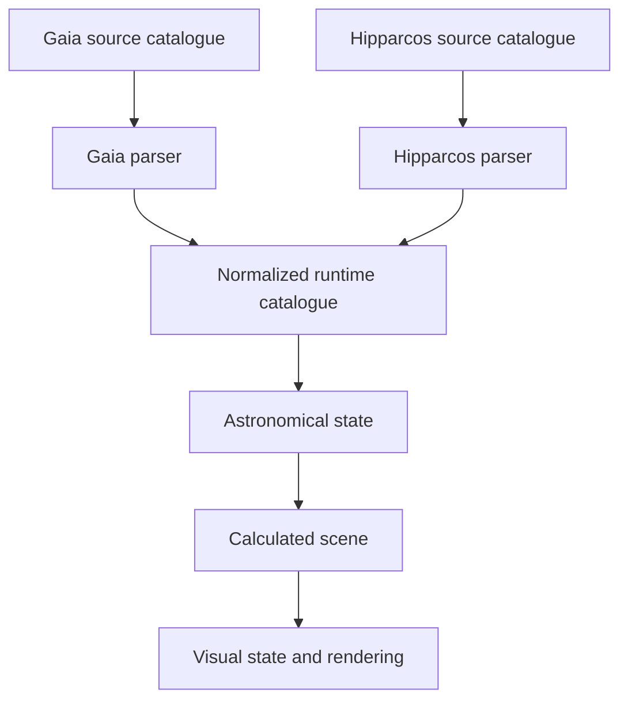

# Catalogue integration and runtime layering

Status: source/runtime boundary and derived-G direction approved on 2026-09-12.
The exact colour-range fallback and identity consolidation still require a
reviewed implementation plan. No Gaia/Hipparcos normalization has been
implemented.

## Approved boundary

Keep Gaia and Hipparcos source files separate. Each catalogue has a
source-specific parser that preserves and validates its native measurements.
Accepted records are later converted into one source-independent runtime
catalogue. Astronomy, scene construction, projection, and rendering consume
that normalized catalogue rather than carrying parallel source pipelines.



The normalized catalogue is a boundary, not an approved C++ class or storage
layout. Its concrete identity, provenance, photometry, conflict handling, and
binary representation still require owner decisions.

Do not append Hipparcos rows to the Gaia CSV. Their identifiers, reference
epochs, magnitude bands, colour indices, schema, provenance, and acquisition
checkpoints differ. Carrying two catalogues through every later stage is also
rejected because it would duplicate sorting, culling, astronomy, rendering, and
benchmark paths.

## The Hp/G problem

Hipparcos `Hp` and Gaia `G` are measurements through different passbands. A
smaller value is brighter within either system, but equal numerical values do
not promise equal measured brightness. The current Hipparcos supplement was
selected with a provisional native `Hp` threshold copied numerically from the
brightest acquired Gaia `G` value. That makes the supplement useful for
experimentation, but it does not prove completeness at a common brightness
boundary.

The project has four defensible choices:

1. Retain native magnitude plus an explicit passband and map each passband to
   display intensity separately. This preserves evidence and is the smallest
   honest M1 solution, but the two display mappings remain an approximation.
2. Derive an estimated Gaia-like G magnitude from Hp and available colour. This
   gives one sortable selection value, but it needs an authoritative empirical
   transformation, a documented valid colour range, and a policy for rows
   outside that range. The result must remain labelled as derived.
3. Enrich the bright stars from another catalogue that supplies a common
   photometric band. This can improve consistency, but introduces another
   catalogue, matching rules, licences, and missing-data cases.
4. Convert measurements into a physical or synthetic photometry model. This is
   the most general option and the largest piece of premature architecture for
   the current milestone.

The owner selected a derived Gaia-G estimate and delegated the offline
cross-catalogue preparation path. Gaia EDR3 documentation publishes:

```text
G - Hp = -0.02392 - 0.4069(B-V) + 0.04569(B-V)^2 - 0.0452(B-V)^3
```

The fit has a reported scatter of 0.02417 magnitude and a documented range of
`-0.25 < B-V < 1.9`. Above `B-V = 1.4`, it is only valid for M giants. The same
source publishes an Hp/V-I relationship with wider applicability but larger
0.08191-magnitude scatter. The recommended preparation rule is therefore to use
B-V in its unambiguous range and V-I as a fallback for very red or otherwise
out-of-range rows, while retaining native Hp, colour, and derivation provenance.
This fallback is recommended but has not been implemented.

All 117,955 Hipparcos-2 rows contain finite Hp, B-V, and V-I values. Of these,
117,440 fall in the broad B-V range. Applying the B-V formula within that range
produces 62 candidates brighter than the current Gaia boundary, compared with
42 selected by comparing raw Hp numerically. Fourteen of the 62 have B-V above
1.4 and therefore expose the giant/dwarf limitation. A B-V-primary/V-I-fallback
rule covers 117,904 rows, leaving 51 outside both conservative ranges.

Do the conversion and official Gaia cross-match during offline catalogue
preparation. Cross-match only the small derived bright candidate set. When a
validated match has a Gaia record satisfying the required measurement contract,
prefer Gaia; otherwise retain the Hipparcos-derived record. The unresolved HIP
71681 association shows that publication in the best-neighbour table alone is
not sufficient validation. The application then reads one generated runtime
catalogue and does not pay for cross-catalogue matching.

## Stellarium as a reference

Stellarium uses a practical version of the same broad idea: source catalogues
are prepared into one application-specific binary system, then split into
consecutive magnitude layers and geodesic sky zones. Its current configuration
ships the first four layers, about 587,000 stars and roughly 20.5 MB, while five
larger layers are optional downloads. The configured layers exceed 220 million
entries and reach approximately magnitude 18. It memory-maps catalogue files
where supported and visits relevant zones and magnitude levels while drawing.

The current configuration's rounded layer counts sum to approximately
220.487 million stars when all nine levels are installed. The first four levels
distributed with the application sum to approximately 587,000 stars. These are
configuration estimates in millions, not exact record counts from parsing every
binary catalogue.

Stellarium is a useful architectural and validation reference for future Solar
System objects and meteors, but its star catalogue is not their database.
Planets use separate ephemeris models and optional JPL numerical ephemerides;
meteor showers use a separate plugin and catalogue plus generated individual
meteor events. MSC should evaluate those sources and models independently when
their milestones begin. Stellarium's GPL implementation can be studied and used
for behavioral comparison, while copying its code would introduce GPL licensing
obligations.

The useful principles for MSC are:

- preserve source provenance during preparation;
- expose one normalized runtime contract;
- derive nested brightness levels instead of duplicating complete catalogues;
- distribute very large levels separately with manifests and checksums;
- add spatial partitioning and memory mapping when profiling establishes their
  value.

MSC should not copy Stellarium's `.cat` files or its packed record format now.
Those files are tailored to Stellarium's fields, precision, rendering, and
licensing/provenance chain. Using them directly would also remove much of the
catalogue and performance engineering this portfolio project is intended to
demonstrate.

A compatible MSC direction is therefore a bright Hipparcos-derived level plus
deeper Gaia-derived levels, all generated into one MSC runtime format. The
level boundary must use a selected common or derived brightness policy; raw Hp
and G values cannot silently share one ordering. Geodesic zones, memory mapping,
and selective level loading remain later measured optimizations.

## Verified Hipparcos evidence

The 2026-09-12 acquisition selected 42 rows with native `Hp < 1.9425238`.
Forty have no published Gaia best-neighbour row. Two have published neighbours,
but both Gaia records lack proper motion and parallax and therefore fail the
current nine-required-field Gaia contract. One returned association, HIP 71681,
has an unresolved large Hp/G discrepancy. None of these facts supplies a general
identity or photometric-conversion rule.

## Decisions still required before normalization

- the runtime identity and catalogue-provenance model;
- duplicate/cross-match precedence when both sources provide a usable record;
- the precise B-V/V-I fallback boundaries and derived-value provenance;
- conflict handling when source measurements disagree;
- whether magnitude layers are first introduced during binary preparation or
  only after the 4,096-row baseline is measured.

## References

- [Gaia EDR3 photometric relationships](https://gea.esac.esa.int/archive/documentation/GEDR3/Data_processing/chap_cu5pho/cu5pho_sec_photSystem/cu5pho_ssec_photRelations.html)
- [Stellarium catalogue configuration](https://github.com/Stellarium/stellarium/blob/master/stars/hip_gaia3/defaultStarsConfig.json)
- [Stellarium user guide](https://stellarium.org/files/guide.pdf)
- [Stellarium StarMgr](https://github.com/Stellarium/stellarium/blob/master/src/core/modules/StarMgr.cpp)
- [Stellarium ZoneArray interface](https://github.com/Stellarium/stellarium/blob/master/src/core/modules/ZoneArray.hpp)
- [Stellarium ZoneArray implementation](https://github.com/Stellarium/stellarium/blob/master/src/core/modules/ZoneArray.cpp)
- [Hipparcos-2 supplement record](../hipparcos2-datasets.md)
