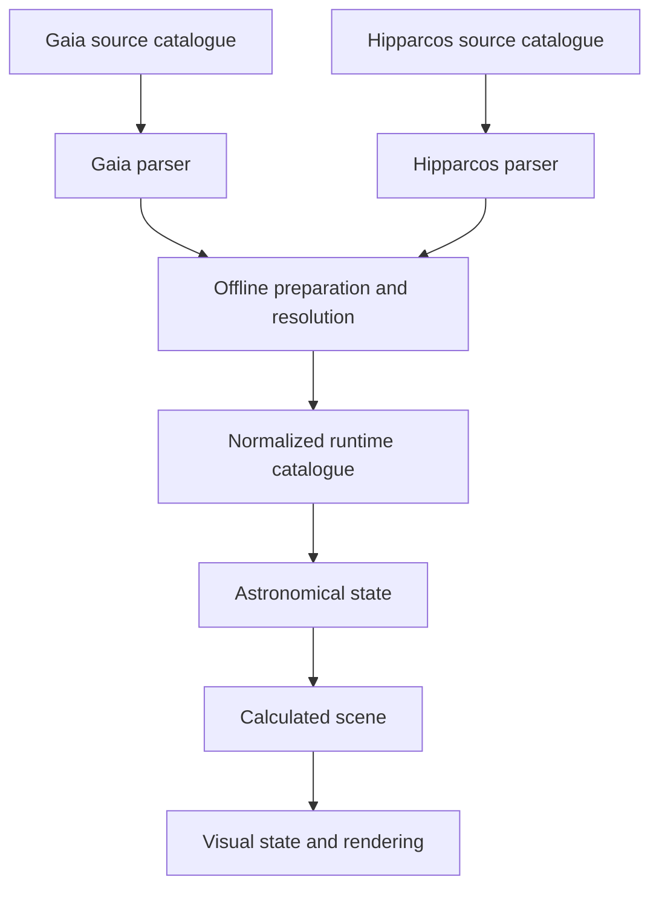

# Catalogue integration and runtime layering

Status: source/runtime boundary and offline Hipparcos preparation implemented on
2026-09-12. Runtime normalization remains an approved direction whose concrete
C++ representation still needs owner review.

## Approved boundary

Keep Gaia and Hipparcos source files separate. Each source has its own parser and
preserves native measurements. Offline preparation resolves overlap, after which
accepted records are converted into one source-independent runtime catalogue.
Astronomy, scene construction, projection, and rendering consume that normalized
catalogue rather than carrying parallel catalogue pipelines.

The normalized catalogue is a boundary, not an approved C++ class or storage
layout. Its identity, provenance, source-measurement representation, and binary
encoding remain visible owner decisions.

Appending Hipparcos rows to the Gaia CSV is rejected because identifiers,
reference epochs, magnitude bands, colour indices, schemas, provenance, and
acquisition checkpoints differ. Carrying two catalogues into astronomy and
rendering is also rejected because it duplicates sorting, culling, transformation,
drawing, and benchmark paths.

## Implemented Hp-to-G preparation

Hipparcos Hp and Gaia G use different passbands, so equal numerical magnitudes do
not imply equal brightness. The original raw-Hp cutoff was provisional. It has
been replaced by an explicitly derived Gaia-like G selection value using official
Gaia EDR3 photometric relationships.

Use the Hp/B-V relation for `-0.25 < B-V <= 1.4`, where its applicability is
unambiguous and its reported scatter is 0.02417 magnitude. Use the wider Hp/V-I
relation for `-0.25 < V-I < 5.0` when the primary relation is unavailable; its
reported scatter is 0.08191 magnitude. Preserve Hp, B-V, V-I, the derived value,
and the method. Rows outside both ranges do not become bright candidates.

The full Hipparcos-2 source has 117,955 rows complete in the ten required native
fields. The implemented policy derives G for 117,904 of them and selects 63 below
the current Gaia boundary. The previous raw-Hp rule selected only 42 and therefore
missed valid bright candidates under the chosen common ordering.

Cross-match only those 63 candidates through the official Gaia DR3 best-neighbour
table. Prefer a Gaia record only when the published link supplies all nine MSC
fields and that source is within the recorded local Gaia snapshot. Otherwise
retain the Hipparcos-derived record. The current 76,048,576-row Gaia snapshot
already contains one complete candidate, so the generated supplement contains
62 rows. This implements the preparation policy without changing the application
loader yet.

A published best neighbour remains evidence rather than proof. HIP 71681's large
photometric discrepancy demonstrates why a match cannot be trusted merely because
it exists. The preparation preserves the evidence and retains Hipparcos whenever
the Gaia record is incomplete.

## Stellarium as a reference

Stellarium prepares source catalogues into an application-specific binary system,
then separates stars into magnitude layers and geodesic sky zones. Its default
configuration ships smaller layers and offers larger levels separately. It can
memory-map catalogues and visit relevant zones and magnitude levels during
rendering.

The configured layers total approximately 220 million stars; this is a rounded
configuration estimate rather than an exact recount of every record. Stellarium
is a useful architectural and validation reference, including later independent
planet and meteor systems, but MSC should not copy its packed catalogues now.
Their fields, precision, provenance, and GPL-connected implementation choices are
tailored to Stellarium and would remove catalogue/performance engineering that
MSC is intended to demonstrate.

Principles worth retaining for later measured work:

- preserve source provenance during preparation;
- expose one normalized runtime contract;
- derive nested brightness levels instead of duplicating complete catalogues;
- distribute large levels separately with manifests and checksums;
- introduce spatial partitioning and memory mapping only after profiling.

## Decisions still required before runtime normalization

- the normalized identity and provenance representation;
- how native and derived photometry are represented without confusing them;
- conflict reporting if two otherwise usable sources disagree;
- whether magnitude layers first enter binary preparation during M1 or after the
  4,096-row baseline has been measured.

The source-preparation fallback ranges and record precedence are no longer open:
they are implemented and recorded in the dataset manifest.

## References

- [Gaia EDR3 photometric relationships](https://gea.esac.esa.int/archive/documentation/GEDR3/Data_processing/chap_cu5pho/cu5pho_sec_photSystem/cu5pho_ssec_photRelations.html)
- [Stellarium catalogue configuration](https://github.com/Stellarium/stellarium/blob/master/stars/hip_gaia3/defaultStarsConfig.json)
- [Stellarium StarMgr](https://github.com/Stellarium/stellarium/blob/master/src/core/modules/StarMgr.cpp)
- [Stellarium ZoneArray interface](https://github.com/Stellarium/stellarium/blob/master/src/core/modules/ZoneArray.hpp)
- [Hipparcos-2 supplement record](../hipparcos2-datasets.md)
