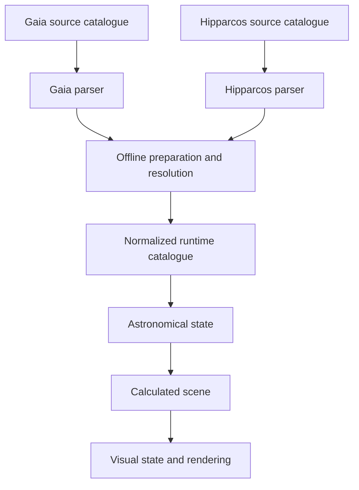

# Catalogue integration and runtime layering

Status: M2 RGB8 catalogue preparation and coloured viewing implemented on
2026-10-25 under owner approval. Earlier dated sections below retain historical
M1/version-2 decisions; this current contract supersedes their storage/epoch rules.

## Current prepared catalogue — 2026-10-25

Each source parser prepares complete `Star` baselines with observed linear-sRGB
colour in three `uint8_t` channels, separate double-precision G-like magnitude,
and positions propagated to J2016. Gaia BP-RP and Hipparcos B-V have distinct
temperature conversions; see the [colour model](stellar-colour.md). The fixed
viewer consumes prepared positions without repeating proper-motion propagation.
Measured proper-motion components and parallax are retained under the accepted
M2 approximation, rather than claiming a fully rebased astrometric solution.

Binary version/schema 3 keeps the 32-byte little-endian header and uses 68-byte
records, independent of C++ padding:

| Record offset | Field | Encoding |
| ---: | --- | --- |
| 0 | Native source ID | uint64 |
| 8 | Position reference epoch | binary64, exactly J2016 |
| 16, 24 | Right ascension, declination | Two binary64 values, degrees |
| 32, 40 | Proper motion in RA*cos(dec), declination | Two binary64 values, mas/year |
| 48 | Parallax | binary64, mas; negative measurements remain valid |
| 56 | G-like apparent magnitude | binary64 |
| 64, 65, 66 | Linear sRGB red, green, blue | Three uint8 values, divided by 255 |
| 67 | Source catalogue | uint8: Gaia=0, Hipparcos=1 |

Writer validation requires J2016 before opening the destination. Readers check
that epoch and the existing numeric, identity/provenance and file-length
invariants. Versions 1 and 2 are rejected with a rebuild instruction. Native
colour indices and the colour-presence flag are no longer binary fields.

Source mapping is explicit: astrometry changes units/epoch as needed; Gaia G or
prepared Hipparcos `estimated_g` supplies magnitude; Gaia BP-RP or Hipparcos B-V
supplies RGB. Hipparcos Hp and B-V/V-I already contribute to upstream G estimation.
The original indices and `g_estimation_method`/`resolution_reason` remain in the
source CSVs, available for rebuilding, rather than in the runtime record.
Malformed/incomplete rows and failed position preparation are skipped and counted
in the existing aggregate warning. No fake default colour fills a missing input.

Hipparcos-first membership, brightness ordering, capacity/prefix semantics and
safe temporary-file publication are unchanged. A real-data 4096-record build
retained all 62 supplement stars and 4034 Gaia stars, with exact source magnitude
values, complete RGB, J2016 positions, sorted order and a 278560-byte output.
This does not redo cross-matching or scan the full Gaia archive.

## Approved boundary

Keep Gaia and Hipparcos source files separate. Each source has its own parser and
preserves native measurements. Offline preparation resolves overlap, after which
accepted records are converted into one source-independent runtime catalogue.
Astronomy, scene construction, projection, and rendering consume that normalized
catalogue rather than carrying parallel catalogue pipelines.

The bounded runtime uses `msc::catalogue::CatalogueStar` with a native
`uint64_t` identifier, an owned `msc::core::astronomy::Star` value, and a separate
`CatalogueSource : uint8_t` enum (`GaiaDr3`, `Hipparcos2`). No identifier bits are
reserved; classification and its bit scheme remain open. `colour()` is optional
Gaia BP-RP: Gaia values survive unchanged; Hipparcos colour is absent. Hipparcos
`estimated_g` supplies the common ordering/display magnitude, identified as
estimated by provenance. Native Hp/B-V/V-I, estimation method, and resolution
evidence remain in the unchanged source supplement, rather than the hot record.

Separate gzip parsers normalize records before one stable sort by ascending
G-like magnitude, catalogue, then native ID; identical keys retain input order.
The current ordered Gaia prefix contributes 4096 records, the resolved supplement
62; truncating the combined set to 4096 retains all 62. This is a small vector
baseline, not a new deduplication or large-catalogue preparation system.

Binary version/schema 2 retains the 32-byte header and uses 74-byte records:
the original ID and eight binary64 slots, followed by a provenance byte and a
colour-presence byte. An absent colour has zero padding in its unused slot,
never a runtime numeric colour. Version 1 is rejected; rerun the CLI to regenerate
its derived binary. Source epochs and directions remain native in storage;
[scene propagation](stellar-motion.md) calculates Hipparcos directions at J2016.

Appending Hipparcos rows to the Gaia CSV is rejected because identifiers,
reference epochs, magnitude bands, colour indices, schemas, provenance, and
acquisition checkpoints differ. Carrying two catalogues into astronomy and
rendering is also rejected because it duplicates sorting, culling, transformation,
drawing, and benchmark paths.

## Baseline regeneration — 2026-10-24

The existing pipeline was rerun through a temporary C++ driver linked against the
rebuilt libraries: `load_gaia_csv_gzip(..., 4096)` stopped after 4096 accepted
records from `data/gaia-dr3/gaia-dr3.csv.gz`; the existing Hipparcos loader read
`data/hipparcos2/runs/20260912T191816.016104Z/hipparcos2-supplement.csv.gz`.
Both inputs had zero rejected rows. Existing `select_brightest(..., 4096)` retained
all 62 supplement records. The existing binary writer and quantity-aware reader
verified 4096 records, schema/version 2, and 303136 bytes. The binary was installed
at the configured default `mystarceiling/catalogue.bin` beneath the local data
root; the existing configuration was preserved.

Binary SHA256: `639988203a2549bc84e923df07234d116b0f37c289cff9cf710a10ecfc776bf3`.
Window-free default launch preparation produced 125 points, zero propagation
failures and 720 temporary magnitude exclusions; no graphical review was made.
The Gaia archive was neither fully scanned nor rehashed. The supplement remains
tied to the older 76,048,576-row snapshot and was **not** freshly cross-matched
against the completed 134,217,728-row archive; see the
[acquisition caveat](../project-state.md#acquisition-status).

## Catalogue command integration — 2026-10-24

`msc catalogue build` now exposes the existing parsers, selector and binary
encoding through strict TOML settings and temporary CLI overrides. The owner
changed membership to Hipparcos-first: retain usable supplement records up to
capacity, fill remaining slots from the ordered Gaia prefix, then sort the chosen
records using the existing common magnitude/catalogue/ID ordering. If Hipparcos
fills capacity, no Gaia source is opened. Exact capacity, replacement protection
and checked temporary-file publication follow the
[application contract](application-controls.md#catalogue-controls).

A real-data build with capacity 4096 consumed the current 62-record supplement
and 4034 accepted Gaia rows. Its 303136-byte output matches the SHA256 above,
so this baseline selection is unchanged. This does not revalidate the supplement's
overlap preparation against the final Gaia archive. No full archive scan was made.

## Implemented Hp-to-G preparation

Hipparcos Hp and Gaia G use different passbands, so equal numerical magnitudes do
not imply equal brightness. The original raw-Hp cutoff was provisional. It has
been replaced by an explicitly derived Gaia-like G selection value using official
Gaia EDR3 photometric relationships.

Use the Hp/B-V relation for `-0.25 < B-V <= 1.4`, where its applicability is
unambiguous and its reported scatter is 0.02417 magnitude. Use the wider Hp/V-I
relation for `-0.25 < V-I < 5.0` when the primary relation is unavailable; its
reported scatter is 0.08191 magnitude. Preserve Hp, B-V, V-I, the derived value,
and the method. Rows outside both ranges do not become bright candidates.

The full Hipparcos-2 source has 117,955 rows complete in the ten required native
fields. The implemented policy derives G for 117,904 of them and selects 63 below
the current Gaia boundary. The previous raw-Hp rule selected only 42 and therefore
missed valid bright candidates under the chosen common ordering.

Cross-match only those 63 candidates through the official Gaia DR3 best-neighbour
table. Prefer a Gaia record only when the published link supplies all nine MSC
fields and that source is within the recorded local Gaia snapshot. Otherwise
retain the Hipparcos-derived record. The current 76,048,576-row Gaia snapshot
already contains one complete candidate, so the generated supplement contains
62 rows. The M1 application now consumes that resolved supplement.

A published best neighbour remains evidence rather than proof. HIP 71681's large
photometric discrepancy demonstrates why a match cannot be trusted merely because
it exists. The preparation preserves the evidence and retains Hipparcos whenever
the Gaia record is incomplete.

## Stellarium as a reference

Stellarium prepares source catalogues into an application-specific binary system,
then separates stars into magnitude layers and geodesic sky zones. Its default
configuration ships smaller layers and offers larger levels separately. It can
memory-map catalogues and visit relevant zones and magnitude levels during
rendering.

The configured layers total approximately 220 million stars; this is a rounded
configuration estimate rather than an exact recount of every record. Stellarium
is a useful architectural and validation reference, including later independent
planet and meteor systems, but MSC should not copy its packed catalogues now.
Their fields, precision, provenance, and GPL-connected implementation choices are
tailored to Stellarium and would remove catalogue/performance engineering that
MSC is intended to demonstrate.

Principles worth retaining for later measured work:

- preserve source provenance during preparation;
- expose one normalized runtime contract;
- derive nested brightness levels instead of duplicating complete catalogues;
- distribute large levels separately with manifests and checksums;
- introduce spatial partitioning and memory mapping only after profiling.

## First bounded M2 refactor — owner decision, 2026-09-13

The main source-independent `Star` belongs in `core/astronomy`, never catalogue.
It owns validated reference epoch, ICRS direction, proper motion, parallax,
G-like apparent magnitude, and optional BP-RP. The stellar measurement wrappers
and their finite-value validation now live beside it. `CatalogueStar` owns native
identity and provenance and exposes its physical value through `star()`;
astronomy calculations explicitly access that core value. There is no old
`catalogue::Star` alias or forwarding header.

The field-by-field version-2 binary encoding remains unchanged (32-byte header,
74-byte records), as do sorting, parsing errors, and bounded M1 propagation and
display policy. This is an ownership boundary, not a performance layout change.
AI implemented and validated the owner-directed refactor; no additional M2
rendering or control features are included.

## Remaining decisions

- classification taxonomy/bit scheme and any later cold-metadata layout;
- richer native/derived photometry beyond this bounded two-source runtime;
- conflict reporting if two otherwise usable sources disagree;
- whether magnitude layers first enter binary preparation during M1 or after the
  4,096-row baseline has been measured.

The source-preparation fallback ranges and record precedence are no longer open:
they are implemented and recorded in the dataset manifest.

## References

- [Gaia EDR3 photometric relationships](https://gea.esac.esa.int/archive/documentation/GEDR3/Data_processing/chap_cu5pho/cu5pho_sec_photSystem/cu5pho_ssec_photRelations.html)
- [Stellarium catalogue configuration](https://github.com/Stellarium/stellarium/blob/master/stars/hip_gaia3/defaultStarsConfig.json)
- [Stellarium StarMgr](https://github.com/Stellarium/stellarium/blob/master/src/core/modules/StarMgr.cpp)
- [Stellarium ZoneArray interface](https://github.com/Stellarium/stellarium/blob/master/src/core/modules/ZoneArray.hpp)
- [Hipparcos-2 supplement record](../hipparcos2-datasets.md)
