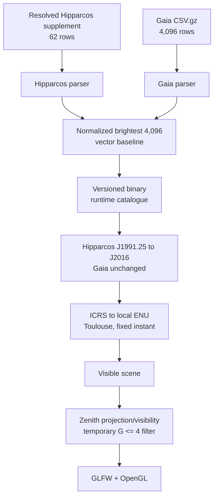

# M1 — Fixed Toulouse sky

Status: complete on 2026-09-13. M2 is the next planning target.

Target: 29 November 2026.

## Objective

Load the 4,096 brightest combined qualifying Gaia DR3 and Hipparcos-2 sources
into the project's typed stellar representation, construct their local
directions for Toulouse at one fixed instant, and render the visible result in
a window. This is the first complete path through catalogue ingestion,
interpretation, astronomy, projection, and rendering.

## Accepted decisions

### Catalogue and domain data

- Use Gaia DR3 and the nested 4,096-record brightness-ordered prefix.
- Keep Gaia-specific parsing separate from the source-independent catalogue and
  astronomical calculations.
- Retain `source_id`, `ref_epoch`, `ra`, `dec`, `pmra`, `pmdec`, `parallax`,
  `phot_g_mean_mag`, and `bp_rp`; every field is required for an accepted row.
- Use `std::uint64_t` for `source_id`.
- Use semantic wrappers for reference epoch, proper motion, parallax, magnitude,
  and colour index, consistent with the existing coordinate wrappers.
- Preserve negative parallax. Direction rendering remains valid; future distance
  conversion must reject nonpositive parallax. Never replace it with its absolute
  value.
- Propagate only Hipparcos directions from J1991.25 to J2016 before the local
  transformation using the approved tangent-vector operation. Preserve native
  source state; skip failures with an aggregate count. Gaia J2016 stays unchanged.
- Use a `std::vector` as the initial catalogue baseline.
- Source brightness and colour measurements remain domain data. The renderer
  derives appearance later instead of storing an RGB pixel in the star record.

### Parsing, errors, and storage

- Read the current CSV-gzip source and reject malformed or incomplete rows.
- Return structured failures with `std::expected`, an explicit error-code enum,
  and relevant context. Human-readable text is optional when useful and is not
  allocated for every normal row rejection.
- Continue after row failures. Count accepted and rejected rows by reason and
  reserve per-row diagnostics for debug or trace logging.
- Treat file, decompression, header, or schema failures as application errors;
  parsing code reports them and does not terminate the process itself.
- Produce a minimal versioned binary runtime catalogue during M1.
- Prefer short fixed-width integer aliases inside `.cc` files; avoid exposing
  project-wide numeric aliases in public headers.

### Observer, time, and rendering

- Use Toulouse at latitude 43.6045 degrees north and longitude 1.4440 degrees
  east.
- Use `2016-01-01 00:00:00 UTC` as the fixed rendering instant.
- Use the Gaia J2016 catalogue positions without proper-motion propagation.
- Keep celestial/local directions in 3D and project them to a 2D rectangular
  view whose camera points at the zenith.
- Use GLFW for the window, input, and OpenGL context, with modern OpenGL for
  rendering.
- Use a 90-degree vertical field of view. With the camera aimed at the zenith,
  the center is straight overhead and the top and bottom edges are 45 degrees
  away from it. Along the vertical centerline this reaches roughly 45 degrees
  above the horizon; it does not show the entire hemisphere. Perspective and
  aspect ratio make the corner coverage wider than the vertical edge coverage.
- Put north at the top of the image and east on the right.
- Preserve future support for other camera directions and projections without
  implementing them in M1.

### Evidence

- Test a small synthetic fixture containing representative malformed and missing
  values.
- Test known real Gaia rows and their interpreted field values.
- Validate known inputs through the entire catalogue-to-screen chain: parsed
  `ra`/`dec`, typed ICRS direction, local ENU direction, horizon visibility,
  perspective coordinates, and final screen region. This catches correct-looking
  individual values combined with the wrong unit, column, longitude sign,
  rotation, screen axis, or clipping rule. Prefer tolerant geometric regions over
  a fragile exact-pixel screenshot comparison.
- Report accepted and rejected totals and allow inspection of at least one loaded
  source identifier.

## Approved implementation explanations

### UTC, UT1, and the M1 transformation

UTC is the civil time scale used by clocks and timestamps. It is based on atomic
time and occasionally receives leap seconds. UT1 instead follows the Earth's
actual rotation, whose speed varies slightly. The difference `UT1 - UTC` is
published as an Earth-orientation correction because the angle of the Earth at a
given instant depends on UT1.

The existing Earth-rotation function therefore asks for UT1. M1 will use the
explicit approximation `UT1 = UTC` and the existing simplified rotation/local
frame path. This is adequate for the first visual baseline, but it introduces a
small rotation error and omits parts of a complete high-accuracy observed-place
calculation. M1 must state that limitation. M3 will select and validate the full
time/frame model rather than silently extending this approximation.

### Why the binary format specifies little-endian values

Byte order matters whenever one number occupies several bytes. Little-endian
stores the least significant byte first; big-endian stores the most significant
byte first. The choice does not change the numerical value, but a reader using
the wrong order interprets different bits as the number.

Most target desktop CPUs are little-endian, so M1 chooses it as the catalogue's
canonical byte order. The emphasis is necessary because a binary file has to
define its encoding independently of the machine that wrote it. M1 will serialize
fields explicitly as little-endian values instead of dumping a C++ object whose
padding, alignment, and layout may change between compilers or builds. A reader
on a big-endian machine can swap bytes or reject the unsupported encoding.

### Binary contract and dependencies

The minimal header contains a file identifier, format version, schema identifier,
record size, and record count. A reader rejects a wrong identifier, unsupported
version/schema, unexpected record size, or file length inconsistent with the
declared count. Stellar physical values use verified IEEE-754 binary64 and source
identifiers use 64-bit unsigned integers.

The build acquires pinned GLFW and GLAD releases through CMake. GLAD generates
OpenGL 3.3 Core bindings in the build directory. A first configuration therefore
needs network access, Python, and GLAD's generation dependencies; generated
third-party files are not stored in the repository.

### Catalogue-to-screen validation

This integration test begins with a known catalogue record and predicts where it
should appear. It verifies each semantic boundary rather than merely checking
that the final pixel is nonblack. A wrong degree/radian conversion, swapped
column, longitude sign, Earth rotation, screen axis, visibility decision, or
projection will move the result outside its expected region and fail the test.

Projection coordinates are tested with numeric tolerances. OpenGL receives a
separate smoke test for context creation and drawing. A screenshot documents M1
visually but is not used as a pixel-perfect automated reference, because driver
and rasterization differences would make that test unnecessarily fragile.

## Starting repository state verified on 2026-09-12

- Existing code provides typed angles, right ascension, declination, latitude,
  longitude, observer location, Julian date, ICRS directions, ICRS-to-ENU
  conversion, Earth rotation angle, and a three-component vector.
- Existing tests cover those primitives and several Toulouse transformations.
- The CLI was a placeholder. No catalogue parser, shared star record, binary
  catalogue, scene, projection, or renderer existed before this milestone work.
- Zlib 1.3.2 and spdlog 1.17.0 are available through the local package metadata.
  GLFW is not currently available through it. The approved build will acquire a
  pinned release through CMake.

## Implementation evidence — 2026-09-12

- Added finite-value wrappers for Gaia reference epoch, proper motion, parallax,
  G magnitude, and BP-RP colour index.
- Added the source-independent nine-field star record and vector load result.
- Added CSV-gzip ingestion with header checking, typed interpretation, continued
  row rejection, aggregate reason counts, and debug-level row diagnostics.
- Added explicit little-endian binary writing and reading with a 32-byte header
  and 72-byte version-1 stellar records.
- Added the independent 90-degree zenith projection with north up and east right.
- Added pinned GLFW and GLAD dependencies through CMake, generated an OpenGL 3.3
  Core loader in the build tree, and added a small renderer for projected stars.
- Replaced the placeholder CLI with the complete 4,096-star path: CSV-gzip load,
  runtime binary write/read, fixed Toulouse transformation, zenith projection,
  aggregate reporting, and window rendering.
- Added tests using a known Gaia DR3 row, malformed and missing values, negative
  parallax, binary round-trip, visibility, projection orientation, and a known
  Gaia source parsed from a gzip row and projected through the fixed M1
  observer/time path.
- Added a minimal display-only brightness hierarchy from Gaia G magnitude. All
  projected stars retain the same three-pixel size and remain visible; relative
  flux is square-root compressed for the display. Exposure control, calibrated
  magnitude mapping, colour, and scintillation remain later work.
- At the original M1 implementation checkpoint, the real repository built
  successfully and all 96 then-discovered tests passed.
- The application smoke test loaded 4,096 real Gaia rows, projected 834 into the
  fixed 90-degree view, created the GLFW/OpenGL context, and entered its draw
  loop. The first reported source identifier was `418551920284673408`.

## Combined M1 update — 2026-09-13

Owner-approved bounded integration adds the resolved 62-row supplement, separate
provenance and optional BP-RP, deterministic brightest-4096 selection, binary
version/schema 2, and Hipparcos scene propagation. See the
[catalogue contract](../decisions/catalogue-integration.md).

A **temporary**, owner-approved Toulouse M1 display cutoff retains G-like
magnitude <= 4.0 after astronomical projection/visibility and before ScreenPoint
creation. The exclusion count includes only otherwise visible records. This is
not an automatic limiting-magnitude model. Future automatic visibility must
replace this provisional policy after its requirements are decided.

Points remain three pixels. Display intensity is `clamp(10^(-0.2*(G+1.5)),0,1)`:
a fixed G=-1.5 white reference and square-root flux compression without the old
0.15 floor. This keeps contrast throughout the displayed range, independently of
catalogue composition. It is an uncalibrated grayscale display choice. No colour,
glow, scintillation, exposure, camera, or GUI controls were added.

Toulouse and the fixed 2016 instant remain fixed M1 inputs, not permanent defaults.
Current local time is the approved future time default; an explicit timestamp
without a timezone means UTC. The future default observer and place-name
resolution remain open.
The CLI now takes Gaia, resolved Hipparcos supplement, and output binary paths;
future CLI/GUI time, location, and display controls are not implemented. Their
interface and division of responsibilities remain open.

Verification: Debug build and 117 C++ tests passed. Real input accepted 4096 Gaia
and 62 Hipparcos rows without rejection, retained all 62 in the selected 4096,
reported zero propagation failures, excluded 720 otherwise visible records at
G>4, and produced 125 screen points. Independent binary/source comparison verified
exact ordering, native IDs/epochs, and unchanged Gaia BP-RP. The owner subsequently
ran the combined application successfully in a graphical session and supplied
the screenshot below, completing the windowed visual review.

## Visual closeout — 2026-09-13

*Owner-supplied screenshot of the combined Gaia/Hipparcos application: Toulouse
at 2016-01-01 00:00 UTC, with a symmetric zenith-centered perspective crop,
90-degree vertical field of view, north up and east right. The temporary G<=4
filter produces 125 rendered three-pixel grayscale points from 4,096 selected
stars, including all 62 Hipparcos supplement records.*

The owner reports that the rendering looks very nice and the magnitude
distribution looks realistic. This is a visual assessment of the uncalibrated
display mapping. The owner did not recognize their usual constellations. The
January zenith crop and their September east-southeast view differ in season,
hour and view; ten years alone does not explain gross pattern changes. No
matched reference comparison has been performed and no mismatch has been
disproved. No constellation recognition is claimed.

The screenshot is visual evidence of the successful graphical run and its
appearance. The automated known-row catalogue-to-screen tests provide positional
and orientation evidence under the documented M1 approximation; the screenshot
alone does not establish those properties. Together with the recorded 117
passing tests, zero propagation failures, 720 G>4 exclusions, and 125 rendered
points, the owner review closes M1 on 2026-09-13. M2 is the next planning target.
